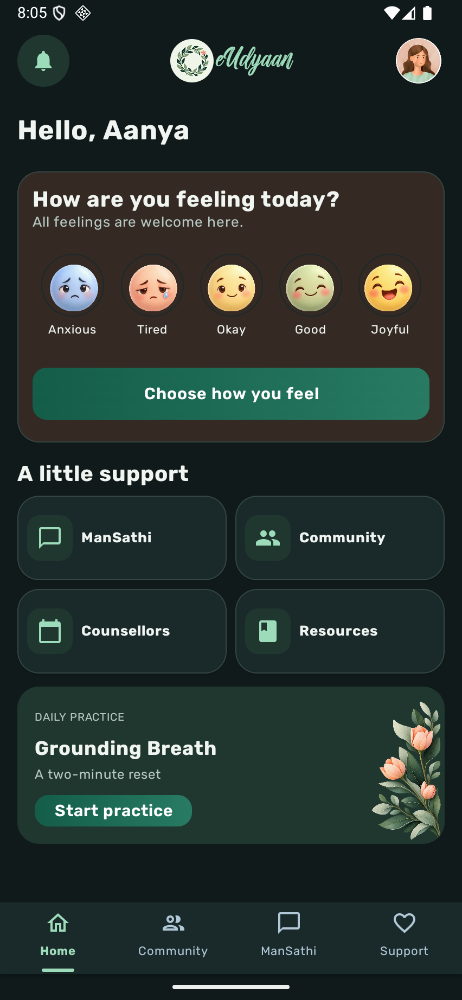
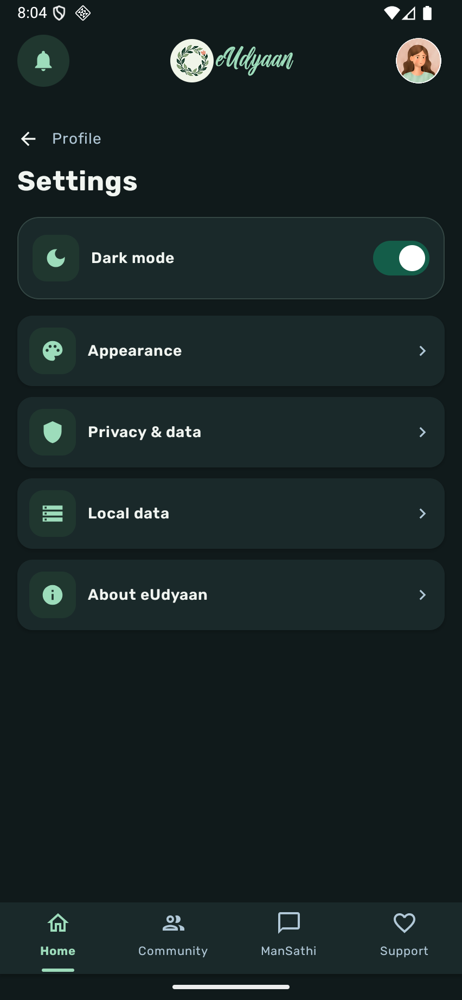
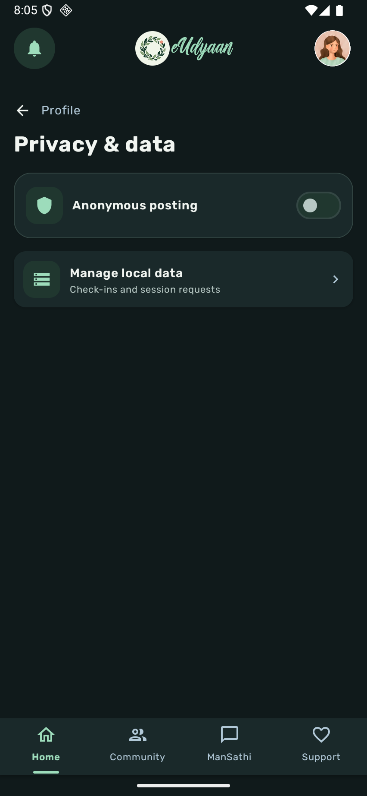
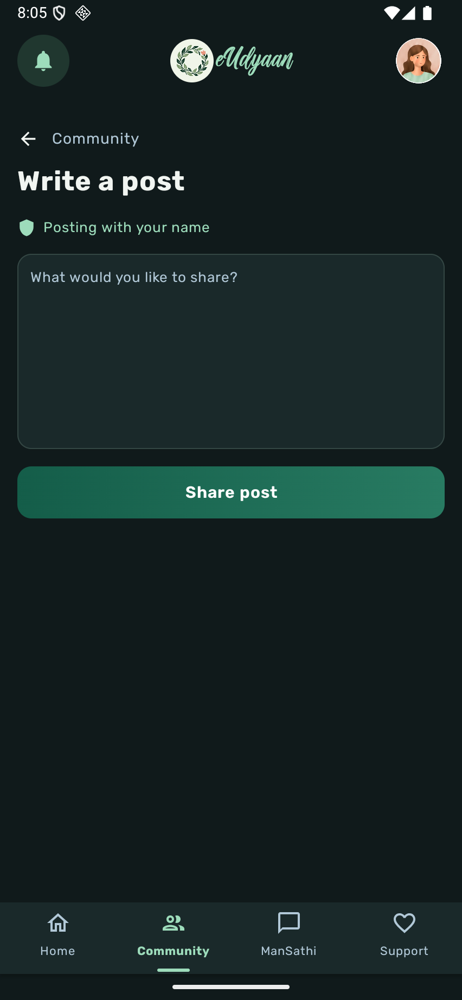

# eUdyaan

eUdyaan is an Android mental-wellness app concept for students. It brings daily reflection, peer connection, self-guided practices, and routes to counsellor support into one calm, accessible interface.

> This repository contains a functional prototype. Several experiences use local demo data and are not connected to live care, moderation, or account services.

## App preview

The following screens were captured from the app running on Android_API36_Slim.

<p align="center">
  
  
  
</p>

<p align="center">
  
</p>

More screen captures, including onboarding, sign-in, counsellor discovery, and dark-mode routes, are available in [`verification/`](verification/).

## Features

- Daily mood check-ins with a dated local mood log.
- Community feed with post creation, replies, likes, sharing, and anonymous-by-default posting controls.
- ManSathi chat experience with locally saved demo messages.
- Guided breathing and meditation screens.
- Counsellor directory, profile details, and a locally saved session request flow.
- Profile and Settings screens for appearance, privacy, local data, personal details, account state, notifications, and app information.
- Light and dark themes, with the dark-mode preference saved on the device.
- Reusable illustrations and visual components for mood reactions, onboarding, the brand mark, and shared controls.

## Download the debug build

[Download eUdyaan.apk](artifacts/eUdyaan.apk)

This is a debug APK for development and evaluation. It is not a signed production release.

## Build and run

Requirements: Android Studio or the Android SDK, JDK 17, and an Android emulator or device.

```bash
ANDROID_HOME="$HOME/Android/Sdk" \
ANDROID_SDK_ROOT="$HOME/Android/Sdk" \
JAVA_HOME="/path/to/jdk-17" \
bash gradlew --no-daemon assembleDebug
```

The generated debug package is `app/build/outputs/apk/debug/app-debug.apk`. The committed copy is at [`artifacts/eUdyaan.apk`](artifacts/eUdyaan.apk).

## Technology

- Kotlin
- Jetpack Compose and Material 3
- Android Gradle Plugin and Gradle Wrapper
- SharedPreferences for the current local prototype state

## Design and typography

The interface uses a warm ivory and sage palette in light mode and a deep green palette in dark mode. Rubik is the app-wide typeface. The supplied Awesome font is used for the eUdyaan wordmark in debug builds only; its license requires written permission for commercial mobile apps. Release builds use Rubik Bold for the wordmark until a commercial license is available. Font license files are in [`licenses/`](licenses/).

The app keeps the original wreath identity and uses a refined wreath variant across its wordmark, splash screen, and adaptive launcher icon. Onboarding uses outlined-character illustrations to explain mood check-ins, community, and support.

## Prototype behavior and limitations

Community posts, likes, replies, chat messages, mood entries, profile preferences, and session requests are currently stored on the device for demonstration. A saved session request does not mean a counsellor received or confirmed it. Sample counsellor listings do not represent real availability or credentials.

The sign-in and sign-up screens expect an account service at `http://10.0.2.2:5000/` in debug builds. Guest access is available without that service. A public release needs a deployed HTTPS service, reviewed secure storage and retention controls, real appointment availability, community moderation and reporting, and a clinically reviewed support experience. Do not use this prototype as a substitute for professional or emergency care.

## Project structure

- `app/src/main/java/com/example/eudayan/redesign/` contains the Compose redesign and screens.
- `app/src/main/res/drawable/` and `app/src/main/res/font/` contain reusable visual and typography assets.
- `app/src/debug/` and `app/src/release/` hold build-variant font resources.
- `verification/` contains emulator screenshots and interaction checks.
- `eUdyaan-redesign-screens/` contains the supplied screen concept package.

## Verification

The debug variant was built and installed on Android_API36_Slim. The app was launched, and the Home, Settings, Privacy, and Community composer screens were captured. The anonymous-posting setting was toggled and confirmed to change the composer label. Dark mode and local persistence flows were also checked during emulator review.

## License

No repository-wide open-source license is currently specified. Included third-party fonts retain their individual license terms in [`licenses/`](licenses/). Review asset and font rights before redistribution or commercial release.
